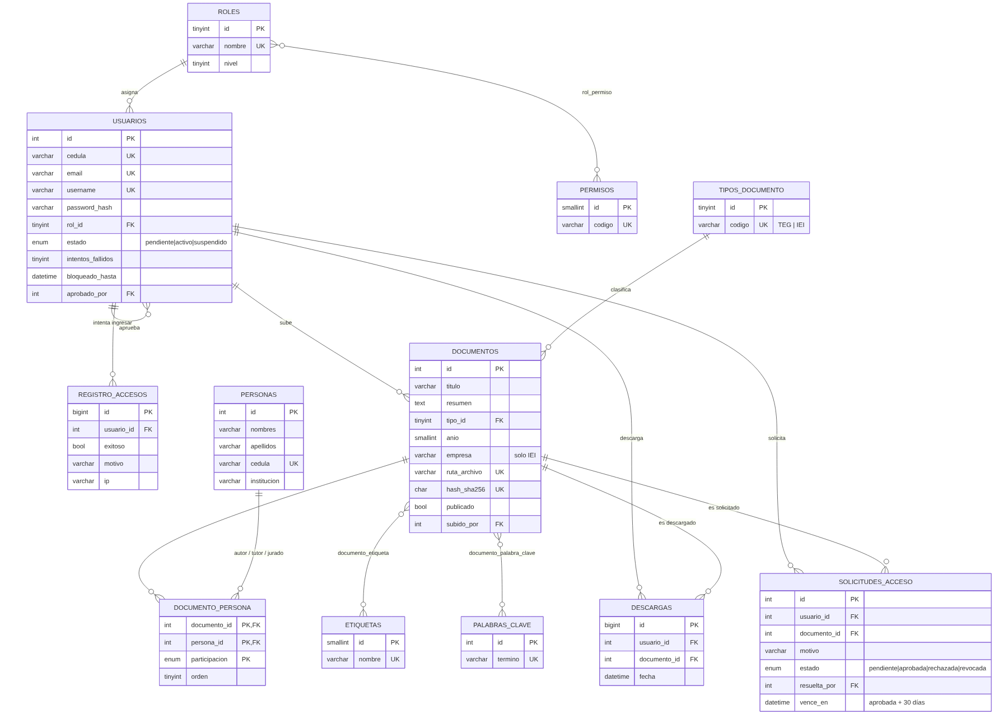
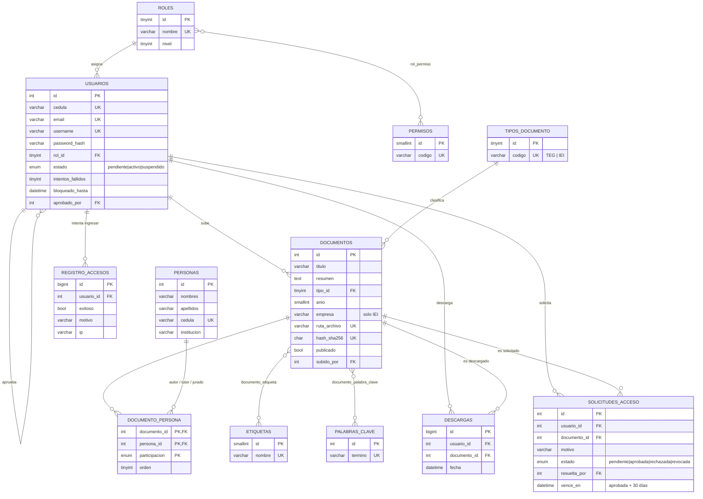

# 1. Modelo Entidad-Relación

El modelo está en **tercera forma normal (3FN)**: ningún dato descriptivo se repite
(un tutor, una etiqueta o una palabra clave existen una sola vez y los documentos
los referencian), y las relaciones muchos-a-muchos se resuelven con tablas puente.

## Diagrama

Fuente Mermaid (editable):

## Tablas explicadas

### Bloque de seguridad (control de accesos basado en roles, RBAC)

| Tabla | Propósito | Claves y reglas |
|---|---|---|
| `roles` | Los 3 perfiles del sistema: administrador, docente y estudiante. `nivel` ordena el privilegio (1 = máximo). | `nombre` único |
| `permisos` | Acciones atómicas, p. ej. `documento.descargar`. El código pregunta por **permisos**, nunca por nombres de rol, así que crear un rol nuevo no exige tocar código. | `codigo` único |
| `rol_permiso` | Relación N:M entre roles y permisos. | PK compuesta |
| `usuarios` | Cuentas. La contraseña se guarda sólo como hash **bcrypt**. `estado` implementa el flujo *registro → pendiente → aprobado por admin*. `intentos_fallidos` y `bloqueado_hasta` frenan ataques de fuerza bruta. | `cedula`, `email`, `username` únicos; `aprobado_por` → `usuarios.id` |

**Matriz de permisos** (fuente única: `backend/app/core/catalogos.py`)

| Permiso | Administrador | Docente | Estudiante |
|---|:-:|:-:|:-:|
| `documento.ver` (buscar, ver ficha y resumen) | ✔ | ✔ | ✔ |
| `documento.leer` (abrir el PDF en línea) | ✔ | ✔ | sólo con solicitud aprobada |
| `documento.descargar` | ✔ | | sólo con solicitud aprobada |
| `documento.editar` (corregir, ocultar o publicar) | ✔ | | |
| `documento.eliminar` | ✔ | | |
| `solicitud.crear` (pedir acceso a una tesis) | | | ✔ |
| `solicitud.gestionar` (aprobar, rechazar, revocar) | ✔ | | |
| `usuario.gestionar` (aprobar, bloquear, cambiar rol, eliminar) | ✔ | | |
| `auditoria.ver` | ✔ | | |

### Bloque de solicitudes de acceso

| Tabla | Propósito |
|---|---|
| `solicitudes_acceso` | Un estudiante pide acceso a **una tesis concreta**, con un motivo opcional. El administrador la aprueba (habilita leer y descargar esa tesis hasta `vence_en`, 30 días), la rechaza con una nota, o revoca un acceso vigente. Una solicitud aprobada cuyo plazo pasó se muestra como *vencida*, y el estudiante puede volver a pedirla. |

### Bloque documental

| Tabla | Propósito |
|---|---|
| `tipos_documento` | Catálogo: `TEG` (Trabajo Especial de Grado) e `IEI` (Informe de Entrenamiento Industrial). Ampliable sin cambiar el esquema. |
| `documentos` | Ficha del trabajo. El PDF **no** se guarda aquí: se guarda en disco y la tabla registra `ruta_archivo`, `tamano_bytes` y `hash_sha256` (detecta duplicados y archivos corruptos). `publicado` permite cargar un documento y revisarlo antes de hacerlo visible. Índice `FULLTEXT` sobre título y resumen para la búsqueda. |

### Bloque de metadatos normalizados

| Tabla | Propósito |
|---|---|
| `personas` | Autores y tutores en **una sola tabla**: un egresado que fue autor en 2015 puede ser tutor en 2024 sin duplicarse. `institucion` distingue al tutor industrial (empresa) del académico. |
| `documento_persona` | Puente N:M con el **papel** de la persona en ese documento (`autor`, `tutor_academico`, `tutor_industrial`, `jurado`) y el `orden` de los autores. Responde consultas como *"todos los TEG tutorados por el Prof. X"*. |
| `etiquetas` | **Vocabulario controlado** que define el departamento (Telecomunicaciones, Control y Automatización, Potencia…). Pocas, estables, sirven para filtros y estadísticas. |
| `palabras_clave` | **Vocabulario libre** tomado de cada documento ("PLC", "LoRa", "filtro Kalman"). Se guardan en minúsculas y sin repetir. |
| `documento_etiqueta`, `documento_palabra_clave` | Puentes N:M. |

> **Etiqueta vs. palabra clave:** la etiqueta responde *"¿a qué área pertenece?"* (la elige el
> administrador de una lista cerrada); la palabra clave responde *"¿de qué trata exactamente?"*
> (la escribe el autor).

### Bloque de auditoría

| Tabla | Propósito |
|---|---|
| `registro_accesos` | Cada intento de inicio de sesión, exitoso o no, con motivo (`password_incorrecta`, `cuenta_bloqueada`, `pendiente_aprobacion`…) e IP de Tailscale. |
| `descargas` | Quién descargó qué y cuándo. Base para estadísticas de uso y para detectar descargas masivas. |

## Archivos relacionados

- `database/schema_mysql.sql` — DDL de producción (MySQL 8).
- `database/seed_mysql.sql` — roles, permisos, tipos y etiquetas iniciales.
- `backend/app/models/` — el mismo modelo en SQLAlchemy (genera el esquema en SQLite para pruebas).
